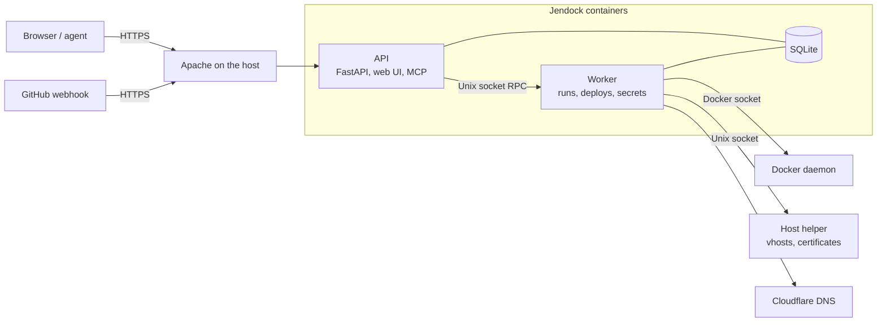

# Jendock

Self-hosted CI/CD for Docker Compose applications on your own server, Jenkinsfile-compatible.

Jendock watches your GitHub repositories, runs your pipeline when you push, builds the Docker
images, deploys them with Docker Compose and rolls back when the new version does not become
healthy. Each project has a **Development** and a **Production** environment, each tracking its
own branch (conventionally `development` and `production`). Everything is operated from a
GitHub-style web UI, a REST API or an MCP endpoint for AI agents.

## Features

**Pipelines**
- A declarative subset of the Jenkins `Jenkinsfile`: stages, parallel branches, `when`, `post`,
  `environment`, `credentials()`, Docker agents, plus platform steps such as `dockerBuild`,
  `deploy` and `healthCheck`. Unsupported syntax is rejected with a positioned message, never
  ignored.
- A visual editor and a text editor over the same pipeline, with server-side validation and a
  dry run.
- A `Jenkinsfile` in the repository wins over the pipeline stored in Jendock.
- Checked against the Declarative linter of a real Jenkins (`make lint-jenkins`).

**Builds and deploys**
- GitHub webhooks (HMAC verified) and manual runs; one pinned commit per run, live logs per step.
- Docker image builds and Compose deployments of exactly the services you name, with health
  checks (sent with a `Jendock-HealthCheck/1.0` user agent), automatic rollback and redeploy of
  earlier versions.
- Checkouts fetch only the pinned commit (depth 1), and the pipeline file is read with a partial
  fetch, so slow links and large histories stay fast.
- After a successful deploy only the images the environment runs are kept (`JENDOCK_IMAGE_RETENTION`
  raises that) and older dangling layers are pruned.
- Auto-deploy per environment.

**On-demand environments**
- Stop and start an environment (`compose stop` / `up -d`; containers and volumes stay), from the
  UI, the API or MCP. A production stop needs the project slug typed to confirm.
- Optional auto-stop of a development environment after N hours (1 to 168) of running.
- A development deploy gives each service without saved limits default limits (0.5 CPU, 512 MiB),
  labelled "Default" and editable.

**Containers**
- Inventory, start/stop/restart, live logs and a web terminal.
- CPU and memory limits applied live, with usage statistics.
- Environment variables and files of a container.

**Database inspector**
- Browse tables and run read-only queries against the PostgreSQL, MySQL and MariaDB databases of
  an environment, from a short-lived helper container on that environment's network.
- **Detect databases** finds the environment's own database containers (a service its services
  depend on, or the only database on a shared network) and creates read-only connections, with
  the password kept in the encrypted secret store and the real Docker network recorded. MariaDB
  is told apart from MySQL, and custom images are recognised by a name segment (for example
  `acme-postgres:16`) or by the server's environment variables. **Detect and clean up** also
  removes out-of-scope auto-detected connections (never hand-added ones, never one with a
  successful backup).

**Database backups**
- A daily dump of every connection to S3 (`mysqldump`/`mariadb-dump` and `pg_dump`), at an hour
  in Cairo time. Production only, unless a maintainer opts a development environment in.
- One latest verified copy per connection: the new object is checked, then older ones are
  deleted; a failed run keeps the old backup and notifies. Dump images are pulled automatically.
  Settings, Backups page, **Back up now** and restore steps: [docs/backups.md](docs/backups.md).

**Domains**
- Cloudflare DNS records (user and account `cfat_` API tokens), an Apache reverse proxy
  configured through the host helper, and ACME certificates with automatic renewal.
- Managed virtual hosts bind the server's public IPv4/IPv6 addresses, so they win over other
  sites on the same Apache.

**Notifications**
- Slack, generic webhook and email, with rules per project and environment, retries and a
  delivery history.

**Users and access control**
- Roles `owner`, `admin` and `member`; members get `viewer`, `developer` or `maintainer` grants
  on a project, an environment or a single container.
- Profile, password change, two-factor authentication (TOTP), session list and an audit log.

**AI agents**
- An MCP server with scoped `jdt_` API tokens: agents can do what their owner may do, nothing
  more.

**Web UI**
- Built with [Primer](https://primer.style/react), the design system of GitHub, with light and
  dark themes, a sticky top bar and a full-height sidebar.

## How it works



- The **API** is the only internet-facing process. It serves the web UI, the REST API and
  `/mcp`. It has **no Docker socket and no encryption key**.
- The **worker** executes runs, deploys with Docker Compose and owns the secret key. The API
  reaches it over a Unix socket with a fixed method allowlist (JSON lines).
- The **host helper** is a small root process on the host that writes Apache virtual hosts and
  certificates from a validated allowlist, reached over a Unix socket.
- **SQLite** holds all state; schema changes are Alembic migrations (`make migrate`).

The code is layered, with no I/O in the domain:
`backend/domain` (values, rules) -> `services` (use cases) -> `repositories` and `adapters`
(database, Docker, git, GitHub, Cloudflare, ACME) -> `api`, `worker`, `mcp`, `cli`; the Jenkinsfile
engine in `backend/pipeline` is pure code and never executes anything. See
[docs/development.md](docs/development.md).

## Quick start

### Local development

```bash
make install                                  # .venv with the dev dependencies
make check                                    # lint, type check, tests

cd frontend && npm ci && npm run dev:mock     # web UI on :5173 against a mocked API
                                              # (login: admin / mock-password-12345)
```

To run the real backend, point it at a scratch directory and start the API, the worker and the
UI dev server (see [frontend/README.md](frontend/README.md)):

```bash
export JENDOCK_DATA_DIR=$PWD/.data JENDOCK_WORKER_SOCKET_PATH=$PWD/.data/worker.sock
export JENDOCK_PUBLIC_ORIGIN=http://localhost:5173
mkdir -p .data && make migrate
.venv/bin/python -m backend.cli users create admin     # first owner, asks for the password
.venv/bin/python -m backend.api                        # API on :8000
.venv/bin/python -m backend.worker                     # in a second terminal
cd frontend && npm run dev                             # proxies /api to :8000
```

### Production

```bash
# on the server, in the release checkout; `docker compose` talks to the host's Docker daemon
cp deployment/env.production.example .env     # then edit it
make preflight PREFLIGHT_ARGS="--env-file .env"
docker compose -f compose.yml -f deployment/compose.production.yml up -d --build
docker compose run --rm api python -m backend.repositories.migrate
docker compose run --rm -T api python -m backend.cli users create admin --password-stdin
```

[docs/deployment.md](docs/deployment.md) is the full procedure: host users and directories, the
Docker socket, Apache, secrets, deploy keys, the webhook, backups and a checklist with a check
per step.

## Configuration

Settings are `JENDOCK_*` environment variables (`backend/config.py`); the compose files expose
the important ones as plain variables in `.env` (see `deployment/env.production.example`).

| Compose variable | Setting | Meaning |
|---|---|---|
| `PUBLIC_ORIGIN` | `JENDOCK_PUBLIC_ORIGIN` | Public https origin; used for cookies, CSRF `Origin` checks and links (required in production) |
| `TRUSTED_PROXIES` | `JENDOCK_TRUSTED_PROXIES` | Proxies whose `X-Forwarded-For` is trusted (IPs/CIDRs); empty trusts nobody |
| `MCP_ALLOWED_HOSTS` | `JENDOCK_MCP_ALLOWED_HOSTS` | Extra `Host` values accepted at `/mcp` |
| `DOCKER_SOCKET_PATH`, `DOCKER_GID` | | Host Docker socket mounted into the worker and its group id |
| `COMPOSE_PROJECTS_DIR` | | Host directory with the compose files of deployed projects, mounted read-only at the same path |
| `WORKSPACES_HOST_DIR` | `JENDOCK_WORKSPACE_HOST_DIR` | Host directory for run workspaces |
| `CONTAINER_MEMORY`, `CONTAINER_CPUS` | `JENDOCK_CONTAINER_MEMORY`, `JENDOCK_CONTAINER_CPUS` | Ceilings for step containers (a pipeline may only lower them) |
| `MAX_CONCURRENT_RUNS` | `JENDOCK_MAX_CONCURRENT_RUNS` | Runs executing at once (default 1) |
| `BACKUP_ENABLED`, `BACKUP_KEEP`, `BACKUP_HOUR_UTC` | `JENDOCK_BACKUP_*` | Scheduled backups (off by default) |
| `GITHUB_STATUS_ENABLED` | `JENDOCK_GITHUB_STATUS_ENABLED` | Report commit status to GitHub |
| | `JENDOCK_BUILD_MEMORY` | Memory ceiling for image builds (default `2g`) |
| | `JENDOCK_IMAGE_RETENTION` | Older images kept per image besides the deployed ones (default 0) |
| | `JENDOCK_AUTO_STOP_INTERVAL` | Seconds between auto-stop checks (default 300) |
| | `JENDOCK_DEV_DEFAULT_CPUS`, `JENDOCK_DEV_DEFAULT_MEMORY_MIB` | Default limits for development services without saved limits (0.5, 512) |
| | `JENDOCK_INSPECTOR_IMAGE` | Helper image for the database inspector |
| `BUILD_NETWORK` | `JENDOCK_BUILD_NETWORK` | Docker network for image builds |
| | | S3 database backups (bucket, region, prefix, hour, dump images) are set in Settings > Integrations, not in the environment ([docs/backups.md](docs/backups.md)) |
| | `JENDOCK_INGRESS_*` | Domains, Cloudflare, Apache and ACME ([docs/ingress.md](docs/ingress.md)) |
| | `JENDOCK_NOTIFY_*` | Notification retries, dedupe and thresholds ([docs/notifications.md](docs/notifications.md)) |

Secrets are never configuration: they are stored encrypted in the database, and the key lives
only in the worker's `keys` volume.

## Security model

- The API has no Docker socket and no secret key; the worker has both and is reachable only
  through a Unix socket that the API alone can open.
- Browser sessions use argon2id passwords, server-side sessions, `__Host-` cookies and CSRF
  protection; API tokens (`jdt_...`) are stored hashed and can never exceed their owner.
- One policy decides every action for the REST API and for MCP tools; production access is
  separate from development access.
- Two-factor keys, project secrets and the webhook secret are handled by the worker only; every
  sensitive action is written to the audit log.

Details, including the trust boundaries and their known limits, are in
[docs/security.md](docs/security.md).

## Documentation

| Document | Contents |
|---|---|
| [docs/deployment.md](docs/deployment.md) | Production installation, checklist, backing out |
| [docs/operations.md](docs/operations.md) | Backup and restore, reproducible builds |
| [docs/backups.md](docs/backups.md) | Daily database backups to S3, retention, restore |
| [docs/security.md](docs/security.md) | Authentication, sessions, roles, tokens, two-factor, audit log |
| [docs/pipelines.md](docs/pipelines.md) | Supported and rejected Jenkinsfile syntax, round trip, editors, example |
| [docs/jenkins-compatibility.md](docs/jenkins-compatibility.md) | Comparison with a real Jenkins linter |
| [docs/execution.md](docs/execution.md) | Runs, deployments, Docker agents, workspaces, logs, cancel and recovery |
| [docs/github.md](docs/github.md) | Webhook, deploy keys, which pipeline a run executes |
| [docs/notifications.md](docs/notifications.md) | Channels, rules, delivery |
| [docs/mcp.md](docs/mcp.md) | The MCP server and its tools |
| [docs/ingress.md](docs/ingress.md) | Domains, Cloudflare, Apache and certificates |
| [docs/ingress-host-helper.md](docs/ingress-host-helper.md) | Installing the host helper |
| [docs/api-contract.md](docs/api-contract.md) | The HTTP API used by the web UI |
| [docs/e2e.md](docs/e2e.md) | The end-to-end acceptance test |
| [docs/development.md](docs/development.md) | Code layout and make targets |
| [frontend/README.md](frontend/README.md) | The web UI: scripts, mock mode, editors |

## Development

```bash
make check            # ruff, mypy (strict) and pytest
make test-docker      # integration tests against a real Docker daemon
make test-e2e         # the whole platform with real containers (several minutes)
make lint-jenkins     # compare the pipeline engine with a real Jenkins linter (needs Docker)
make format           # apply ruff fixes and formatting
cd frontend && npm run check    # typecheck, ESLint, Prettier and Vitest
```

Conventions: object-oriented code with small classes, each use case receiving its collaborators
(a `UnitOfWork`, ports for external systems) instead of using globals; standard protocols and
tools wherever one exists (Jenkinsfile, Compose, OAuth-style bearer tokens, TOTP, ACME, MCP,
Primer); strict typing; one policy for authorization; no secrets in logs, URLs or arguments.
Tests that touch Docker are marked `docker` and clean up everything they create.

Python 3.13 and Node 22 are used. The full list of make targets is in
[docs/development.md](docs/development.md).
